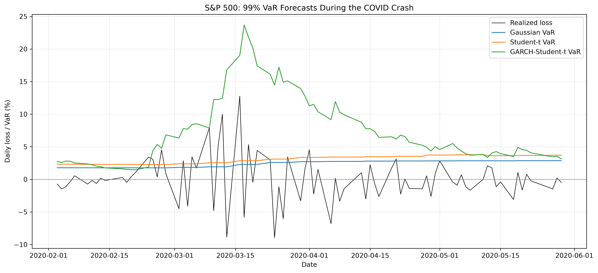
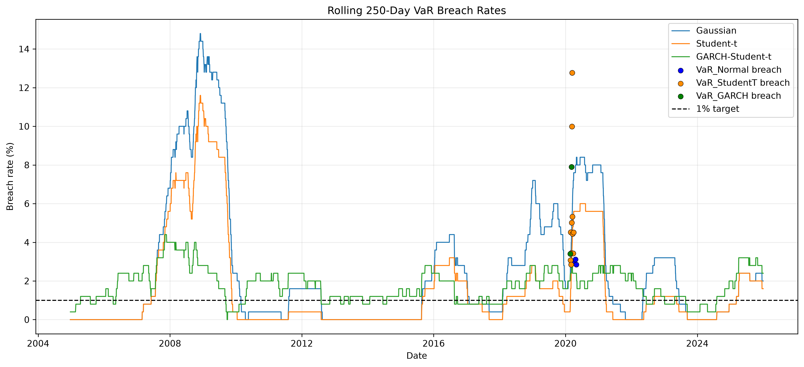
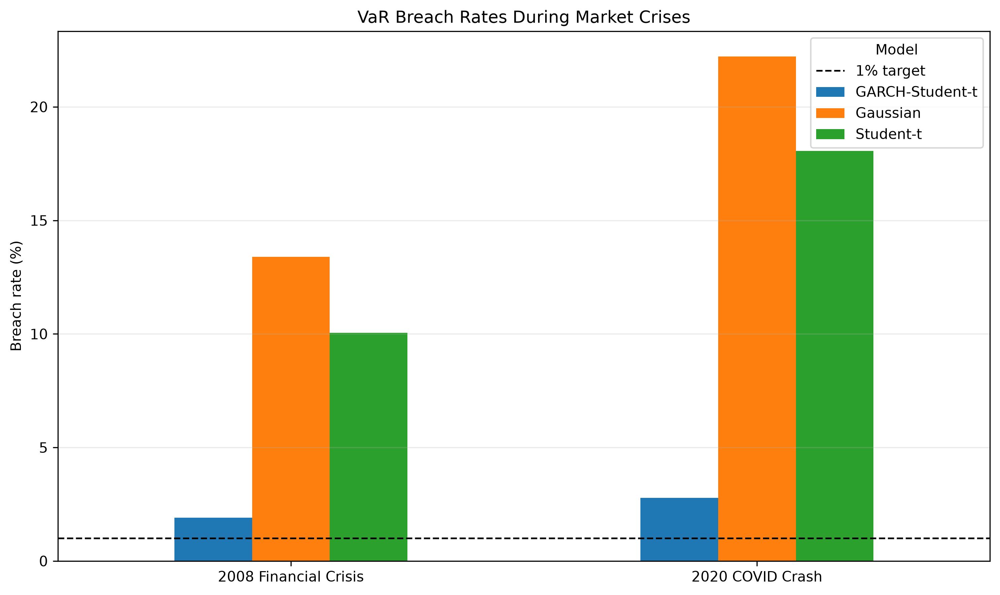

# S&P 500 Tail Risk Forecasting: Gaussian vs. Student-t vs. GARCH

## Overview

This project investigates whether modeling heavy-tailed returns and time-varying volatility improves forecasts of extreme downside risk in the S&P 500.

Using daily S&P 500 returns, I compare three approaches to estimating 99% Value at Risk (VaR) and Expected Shortfall (ES):

- **Gaussian:** A normal-distribution benchmark.
- **Student-t:** A heavy-tailed return model.
- **GARCH-Student-t:** A GARCH(1,1) volatility model with Student-t innovations.

The models are evaluated using rolling out-of-sample forecasts, VaR breach rates, formal backtesting, and crisis-period comparisons covering the 2008 financial crisis and the 2020 COVID-19 market crash.

## Research Questions

1. Does allowing for heavy-tailed returns improve extreme-loss forecasts relative to a Gaussian assumption?
2. Does modeling time-varying volatility improve risk forecasts during periods of market stress?
3. Do the models achieve the expected 1% VaR breach rate, and are their breaches independent over time?

## Methodology

### Data and preprocessing

- **Asset:** S&P 500 index (`^GSPC`)
- **Frequency:** Daily
- **Return measure:** Log returns
- **Forecast horizon:** One trading day
- **Risk confidence level:** 99%
- **Rolling estimation window:** 1,000 trading observations
- **Refitting frequency:** Every five trading days

The analysis uses historical returns to estimate risk forecasts and compares each forecast with the subsequent realized loss.

### Risk measures

**Value at Risk (VaR)** estimates a loss threshold that should be exceeded approximately 1% of the time under a correctly calibrated 99% model.

**Expected Shortfall (ES)** estimates the expected loss conditional on exceeding the VaR threshold. It provides additional information about the severity of losses in the tail.

### Models

**Gaussian model:** Assumes normally distributed returns and provides a benchmark for evaluating the impact of heavier tails.

**Student-t model:** Allows for heavier tails than the Gaussian distribution, potentially improving the representation of extreme returns.

**GARCH-Student-t:** Models conditional volatility using a GARCH(1,1) process and Student-t innovations, allowing risk forecasts to respond to changing market conditions.

### Backtesting

The models are evaluated using:

- **VaR breach rate:** The proportion of realized losses exceeding the forecast VaR.
- **Kupiec unconditional coverage test:** Tests whether the observed breach frequency is consistent with the target 1% rate.
- **Christoffersen independence test:** Tests whether breaches are independent over time.
- **Christoffersen conditional-coverage test:** Combines coverage and independence into a joint test.

Crisis-period breach rates are also compared for September 2008–June 2009 and February–May 2020.

## Key Results

All models were evaluated on 5,538 common out-of-sample observations.

| Metric | Gaussian | Student-t | GARCH-Student-t |
|---|---:|---:|---:|
| Mean VaR | 2.703% | 3.438% | 2.532% |
| Mean ES | 3.101% | 5.964% | 3.259% |
| VaR breaches | 134 | 84 | 96 |
| Breach rate | 2.420% | 1.517% | 1.733% |
| Conditional-coverage p-value | 3.62 × 10⁻²⁵ | 2.14 × 10⁻⁶ | 1.27 × 10⁻⁶ |

The target VaR breach rate is 1%. All three models are rejected by the conditional-coverage test at the 5% significance level.
## Visual Results

### 1. VaR Forecasts During the COVID-19 Crash

This figure compares realized daily losses with the three models' 99% VaR forecasts during the COVID-19 market crash. It illustrates how the models responded to extreme volatility.

### 2. Rolling VaR Breach Rates

The rolling 250-observation breach rate illustrates how forecast performance changes over time. The dashed line represents the theoretical 1% breach rate for a correctly calibrated 99% VaR model.

### 3. Crisis-Period Comparison

This chart compares observed VaR breach rates during the 2008 financial crisis and the 2020 COVID-19 crash. The results highlight differences between static distributional models and the dynamic GARCH-Student-t model.

### Main findings

1. **Heavy tails improve breach frequency.** The Student-t model reduces observed breaches by approximately 37.3% relative to the Gaussian benchmark.
2. **Time-varying volatility changes crisis forecasts.** GARCH-Student-t produces much larger risk estimates during the 2008 and 2020 crisis windows and substantially lower observed crisis-period breach rates.
3. **No model achieves satisfactory full-sample conditional coverage.** Despite differences in breach frequency and timing, all three models fail the joint backtesting test.
4. **More complex models are not automatically better.** GARCH-Student-t does not outperform the static Student-t model on full-sample breach frequency or conditional-coverage test statistic.

## Crisis-Period Results

| Period | Gaussian | Student-t | GARCH-Student-t |
|---|---:|---:|---:|
| 2008 financial crisis | 13.40% | 10.05% | 1.91% |
| 2020 COVID-19 crash | 22.22% | 18.06% | 2.78% |

These are descriptive results over selected crisis windows, not proof that one model is universally superior. The relatively short crisis samples should be interpreted with caution.

## Limitations

- The analysis focuses on a single equity index and does not establish that the findings generalize to other assets.
- Historical rolling estimates depend on the chosen window length and refitting frequency.
- VaR breach frequency alone does not measure the quality of the entire forecast distribution or the severity of tail losses.
- Crisis-period results depend on the selected date windows.
- The conditional-coverage tests reject all three models, indicating that further improvements in calibration may be needed.
- GARCH-Student-t produces exceptionally large forecasts during the COVID crash. Although these forecasts are consistent with a strong volatility response, their economic usefulness should be assessed alongside calibration and forecast conservatism.

## Conclusion

The results suggest that modeling heavy-tailed returns improves extreme downside risk forecasts relative to a Gaussian benchmark, as measured by observed VaR breach frequency. Incorporating time-varying volatility leads to more conservative forecasts during major market crises and reduces crisis-period breaches substantially.

However, none of the models passes the full-sample conditional-coverage test. The findings illustrate the trade-off between capturing extreme market risk, adapting to changing volatility, and maintaining well-calibrated forecasts.

## Technologies

- Python
- pandas and NumPy
- SciPy
- Matplotlib
- `yfinance`
- `arch`

## Reproducibility

The repository contains scripts for data collection, rolling model estimation, VaR and ES forecasting, backtesting, and visualization. The results depend on the data returned by the data provider and the specified estimation settings.

